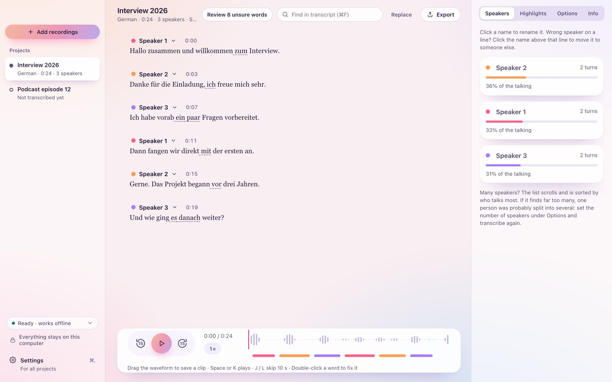
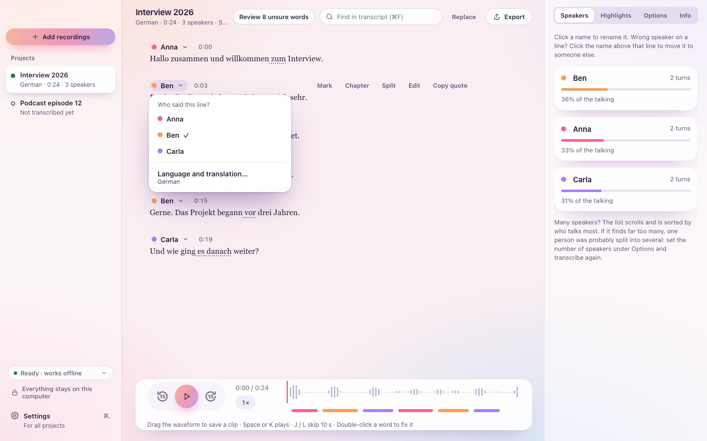
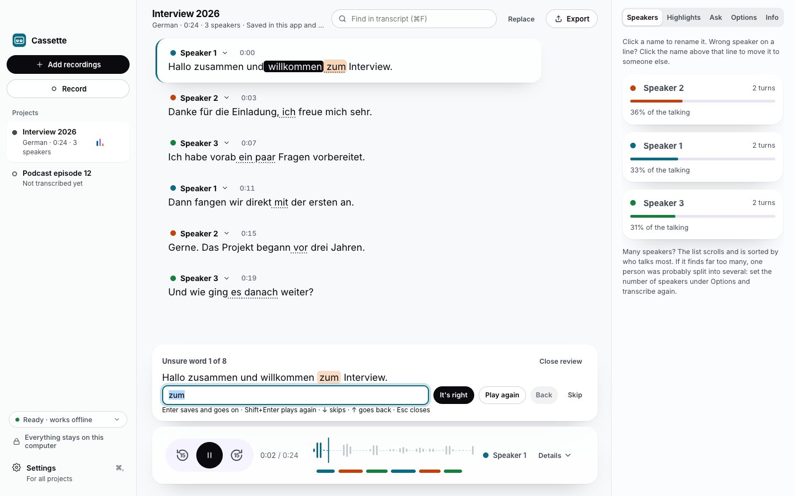
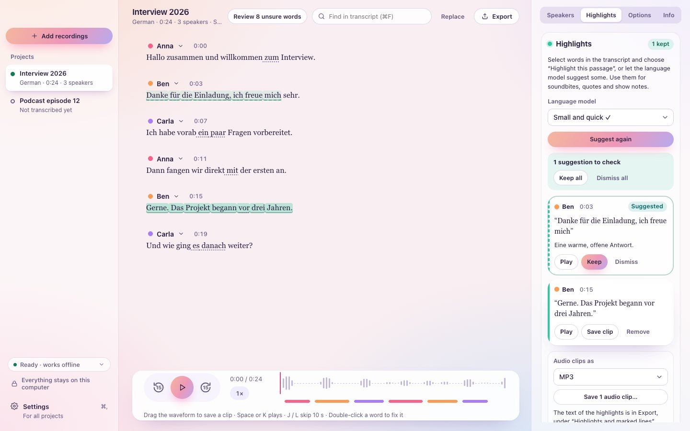
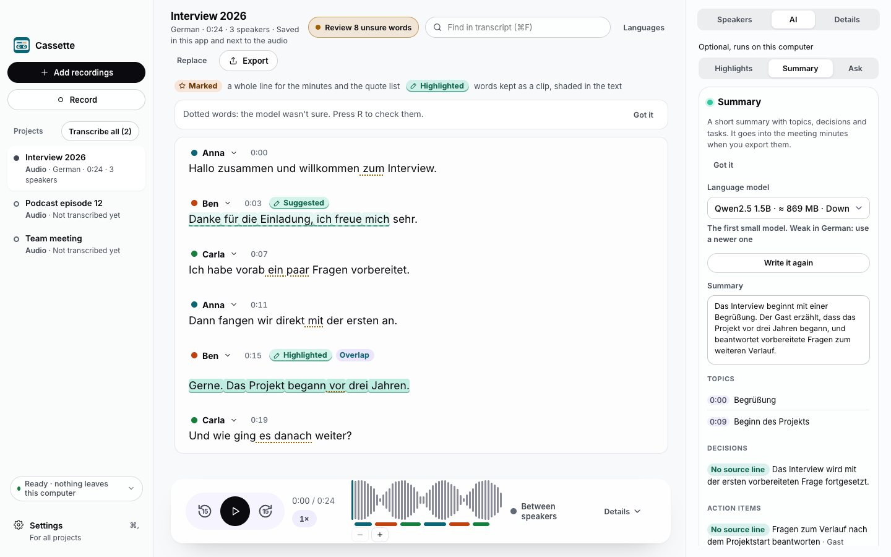
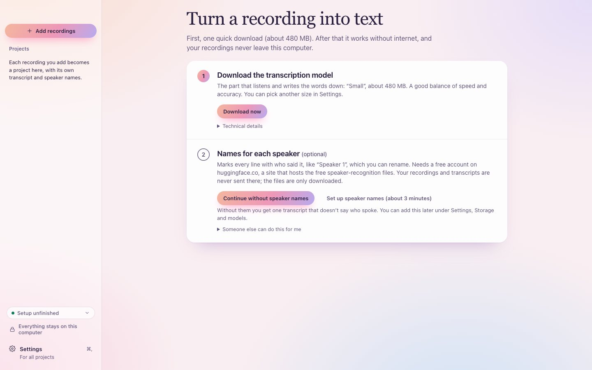

# Cassette

*A local transcriber.*

**Turn a recording into a transcript that says who spoke, without uploading it anywhere.**

Drop in an audio or video file. Get the words, split by speaker, in German, English, French or Spanish
(about 100 other languages work too, with varying accuracy). Transcription and speaker detection run on your
own computer.

<picture>
  <source media="(prefers-color-scheme: dark)" srcset="docs/screenshots/00-hero-dark.jpg">
  
</picture>

## Why use it

- **Private.** Audio and transcripts stay on your machine. No account in the app, no telemetry, no update checks.
- **Works offline.** After a one-time model download it needs no internet.
- **Built for interviews, meetings and podcasts.** Speaker names, chapters, highlights, summaries and exports for the
  tools you already use.

## What you can do

| | |
| --- | --- |
| **Transcribe with speakers.** Each speaker gets a colour and a name you can change. Fix a wrong line in two clicks. | **Check the doubtful words.** Words the model was unsure of are underlined; *Review* steps through them with the audio. |
|  |  |
| **Pick the best quotes.** Select words to highlight them, or let a local language model suggest the most quotable passages. Save each one as an audio clip. | **Get a summary.** Topics, decisions and action items, written on your computer and added to the meeting minutes. |
|  |  |

And also:

- Several languages in one recording: each speaker's language is detected, lines are tagged, and an English
  translation can sit underneath.
- A queue of files, a projects sidebar, a waveform you can click, trim and clip, skip silence, custom vocabulary,
  and a choice of how many speakers there are (automatic, exact or a range).
- Search and replace across the whole transcript; split, join, mark and chapter lines; playback speed.
- The interface is in English, German, French and Spanish (or matches your computer).
- **Export** to Word, meeting minutes, CSV, SRT, VTT, TXT, Markdown, JSON, chapters, DaVinci Resolve markers,
  highlights and a quote list, original-vs-edited, and anonymised text. Text exports can keep or remove "um",
  mark pauses and hide times.


## What your computer needs

| | Minimum | Comfortable |
| --- | --- | --- |
| Memory | 4 GB (use the *Tiny* or *Base* model size) | 8 GB or more (*Small*), 16 GB for *Medium* and *Large* |
| Free disk | 8 GB | 20 GB (models are 0.1 to 3 GB each) |
| Processor | Any 64-bit processor from the last 8 years; more cores means faster | 4 or more cores |
| Graphics card | Not needed | Apple silicon or NVIDIA speeds things up |
| Internet | For the install and the model downloads, once | |

No speed table yet: nobody has timed the app on a low-end Windows laptop. Without a graphics card, expect transcription to
take longer than the recording on the *Small* size and much longer on larger ones; the app shows an estimate before
you press Start.

## Quick start

There is no installer yet, so you run Cassette from this repository. It takes about 10 minutes, most of it
downloads. You need **Git**, **Node.js 22.12 or newer** and **[uv](https://docs.astral.sh/uv/)** (uv also installs
the right Python for you). If you use [`mise`](https://mise.jdx.dev), `mise install` in this folder sets up Node and uv.

### macOS

Tested on Apple silicon (M1 and newer). In Terminal:

```bash
# 1. The tools (skip any you already have). Needs Homebrew: https://brew.sh
brew install git node uv

# 2. Get the app
git clone https://github.com/ingridstevens/cassette.git
cd cassette

# 3. Install, once
cd engine && uv sync
cd ../app && npm ci

# 4. Start it
npm run dev
```

Next time, only step 4 (from the `app` folder).

> **Use `git clone`, not a copied folder.** If you copy the project over AirDrop or from a zip, macOS marks the
> helper programs inside as downloaded and refuses to open them ("Apple could not verify…"). If that happens, run
> `npm ci` in the `app` folder again to get fresh copies.

### Windows

Not tried yet: nobody has run the app on Windows so far. Please
[open an issue](https://github.com/ingridstevens/cassette/issues) if something goes wrong.

**Easiest:** download this repository (the green *Code* button, then *Download ZIP*, and unzip it), open the folder in
PowerShell and run the setup script. It checks your memory and disk space, installs Node.js and uv with `winget` if they are missing,
and installs the app:

```powershell
.\setup.ps1
# if PowerShell refuses to run it:
powershell -ExecutionPolicy Bypass -File .\setup.ps1
```

Then, every time you want to use the app:

```powershell
cd app
npm run dev
```

**By hand**, in PowerShell:

```powershell
# 1. The tools (skip any you already have)
winget install Git.Git OpenJS.NodeJS.LTS astral-sh.uv
# then close PowerShell and open a new one, so it finds them

# 2. Get the app
git clone https://github.com/ingridstevens/cassette.git
cd cassette

# 3. Install, once
cd engine; uv sync
cd ..\app; npm ci

# 4. Start it
npm run dev
```

Highlights and summaries are **not** part of this install on Windows: they need llama.cpp, which has to be compiled
from source (it needs Visual Studio Build Tools). Transcripts, speakers and every export work without it. To add it:
`.\setup.ps1 -Llm`, or `uv sync --extra llm` in the `engine` folder. See [Troubleshooting](docs/troubleshooting.md#windows-and-linux).

Next time, only step 4 (from the `app` folder). Transcription runs on the CPU on Windows unless you have an NVIDIA
graphics card, so start with the *Small* model size. Windows may show a blue "Windows protected your PC" box the first
time a program from this app starts: choose *More info*, then *Run anyway*.

### First run

In the app:

1. **Download the transcription model** (about 480 MB, once). That is all you need for a plain transcript.
2. **Add a recording** (drop a file on the window, or click *Add recordings*) and press **Start**.
3. **Name the speakers, fix the words, export.**



Want speaker names too? That needs a second, small download from Hugging Face, which asks for a free account
and token because the models are *gated*. The app walks you through it in four steps; see
[Getting started](docs/getting-started.md). Someone else can do it once and give you their `models` folder instead.

No recording handy? Try the two short interviews in [`docs/samples/`](docs/samples/).

## Documentation

Everything is in [`docs/`](docs/README.md). The short list:

| I want to… | Read |
| --- | --- |
| Install it and finish the setup | [Getting started](docs/getting-started.md), [Quick start](docs/quick-start.md) |
| See what the app looks like | [A tour of the app](docs/tour.md) |
| Learn every part of the screen | [Using the app](docs/using-the-app.md) |
| Choose a model size | [Which model size?](docs/models.md) |
| Pick quotes, write a summary, replace words | [Highlights and summaries](docs/highlights.md) |
| Save a Word file, subtitles, a spreadsheet | [Exporting](docs/exporting.md) |
| Know what stays on my computer | [Privacy and offline use](docs/privacy-and-offline.md) |
| Fix something that isn't working | [Troubleshooting](docs/troubleshooting.md), [FAQ](docs/faq.md) |
| Change the code | [Development](docs/development.md), [CONTRIBUTING](CONTRIBUTING.md) |

## Privacy in one paragraph

Audio and transcripts stay on your machine (projects live in the app's data folder). The only host the app talks
to is **huggingface.co**, to download models and to check your token; transcription itself runs with the Hugging
Face hub in offline mode. Your token is stored encrypted with Electron `safeStorage`. Details:
[Privacy and offline use](docs/privacy-and-offline.md) and [SECURITY.md](SECURITY.md).

## How it works

| Part | Technology |
| --- | --- |
| Words | [faster-whisper](https://github.com/SYSTRAN/faster-whisper) (tiny to large-v3, including large-v3-turbo) on the CPU; on an Apple chip's graphics chip via MLX-Whisper (optional per-size download, several times faster in our tests); an NVIDIA GPU path exists for Windows and Linux (untested) |
| Speakers | [pyannote](https://github.com/pyannote/pyannote-audio) 3.1, on the Apple GPU or CUDA when available |
| Highlights and summaries | A small local language model you choose (Qwen3, Gemma 3 or Qwen2.5): MLX on Apple chips, llama.cpp elsewhere |
| Window | Electron and React |

## Honest limits

- Only tested on macOS (Apple silicon). Windows and Linux builds are set up in CI, but that workflow has not been run yet, and there is no installer to download.
- On Windows and Linux, highlights and summaries are an opt-in install (`uv sync --extra llm`) because llama.cpp must be compiled.
- Whisper runs on the CPU on a Mac unless you download the Apple GPU version of a model size (Settings → Advanced → Apple GPU models);
  large models on the CPU are slow. On Windows and Linux it is meant to use an NVIDIA GPU, which has never been tried.
  Use `small` or `turbo` for speed.
- Language is detected once per file by default. For recordings with several languages the app checks each speaker and
  detects the language per speaker turn (tried on one short test recording); it cannot follow a switch inside one
  turn, and turns under 0.35 s are skipped. Translation is into English only.
- Overlapping speech is flagged, but its words go to one speaker (the louder one). The flag has only been unit-tested.
- Speaker detection needs a Hugging Face account and token (the models are not bundled), unless someone else
  downloads them and you import their models folder.
- Review mode has been tried in the browser mock with a fake sound, not with real audio in the desktop app.

## Develop

```bash
cd engine && uv sync && uv run pytest -q     # engine + tests
cd app && npm i && npm run dev               # needs `uv` on PATH
```

Package (per OS): `engine/build_engine.sh && cd app && npm run package`. See [CONTRIBUTING.md](CONTRIBUTING.md).
The screenshots in this repository are regenerated by a script; see [Development](docs/development.md#screenshots).

## Licence

Released into the public domain under [The Unlicense](LICENSE): use it for anything. This cannot relicense
third-party software: the dependencies, the FFmpeg binary (GPL in the build inspected) and the downloaded
models keep their own licences. See [THIRD_PARTY_NOTICES.md](THIRD_PARTY_NOTICES.md).
