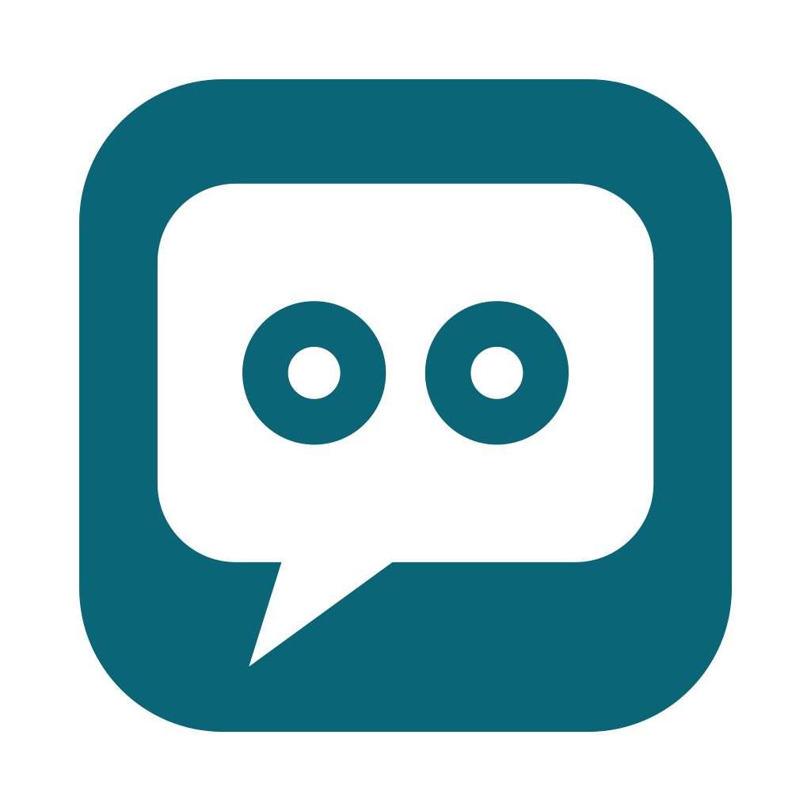
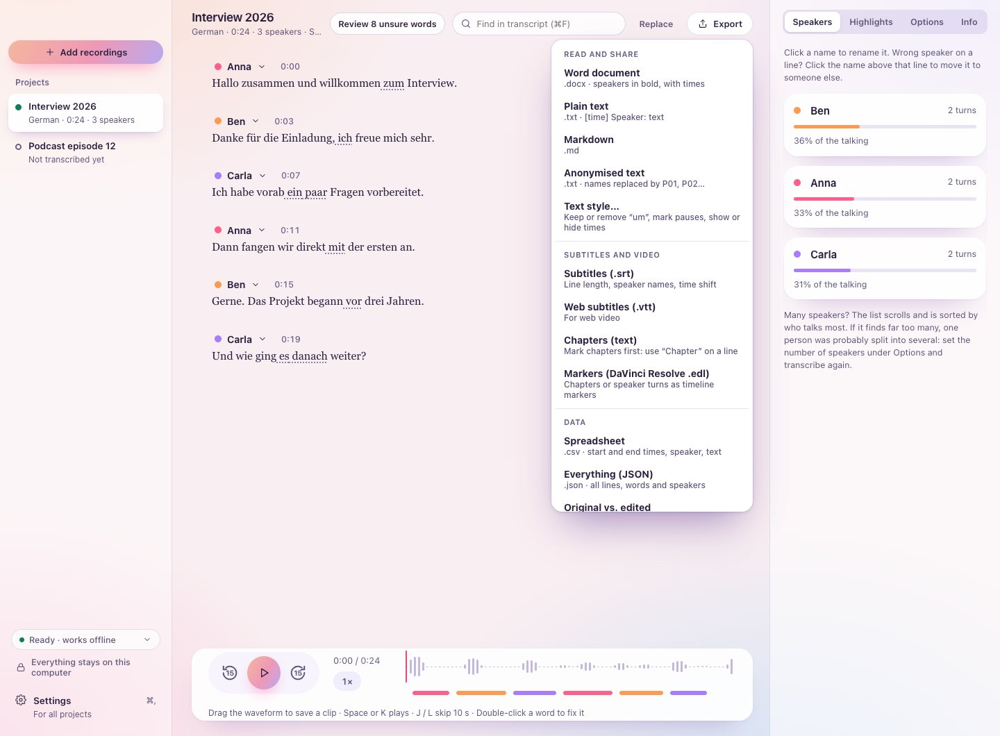

# Cassette

**Turn a recording into a transcript that says who spoke, without uploading it anywhere.**

Drop in an audio or video file and get the words, split by speaker, in German, English, French or Spanish
(about 100 other languages work too, with varying accuracy). Everything runs on your own computer: no account in the
app, no telemetry, no update checks, and it works offline after a one-time model download.

<picture>
  <source media="(prefers-color-scheme: dark)" srcset="docs/screenshots/00-hero-dark.jpg">
  
</picture>

**On this page:** [Features](#features) · [What your computer needs](#what-your-computer-needs) · [Install on Mac](#install-on-mac) · [Install on Windows](#install-on-windows) · [First run](#first-run) · [Documentation](#documentation) · [Privacy](#privacy-in-one-paragraph) · [Limits](#honest-limits)

## Features

**Transcribe**
- Audio and video files; drop them on the window or click *Add recordings*; a queue and a projects sidebar.
- Record from the microphone inside the app.
- Four model sizes from fast to most accurate, with a time estimate before you press Start; engines Whisper, plus Parakeet and Moonshine where they can run.
- Language detected automatically, one language, or several languages in one recording (each speaker checked, lines tagged, English translation underneath).
- Custom vocabulary for names and special words; skip silence; write hesitations ("um", "äh") down or leave them out.

**Speakers**
- Speaker detection with a colour and a name per speaker, and how much each one talked.
- Number of speakers: automatic, exact or a range; or *Transcript only* to skip it.
- Fix a wrong line in two clicks; split and join lines; overlapping speech is flagged.

**Check and edit**
- Doubtful words are underlined; *Review* steps through them with the audio.
- Edit a line or double-click a word to fix it; search and replace across the whole transcript.
- Click the waveform to play; speed 0.75× to 2×; keyboard shortcuts for everything.
- Mark lines as decisions, action items or quotes; add chapters; copy a quote with its speaker and time.

**Find the best parts**
- Select words to highlight them, or let a local language model suggest quotable passages; save each as an audio clip.
- A summary with topics, decisions and action items, written on your computer.

**Export**
- Word, meeting minutes, CSV, SRT, VTT, TXT, Markdown, JSON, chapters, DaVinci Resolve markers, highlights, a quote list, original-versus-edited, and anonymised text.
- Text exports can keep or remove "um", mark pauses and hide times; an optional backup file sits next to each recording.

**Look and accessibility**
- *Clean* look by default (calm blue-green, Inter font), or *Fairytale sunset*; light, dark or match your computer.
- Text size in four steps, High contrast, and an optional *Soft look* (blurred glass, only on computers with plenty of memory). Computers with 4 GB or less get a lighter look by themselves.
- The interface speaks English, German, French and Spanish (or matches your computer); Arabic and Persian are mostly translated (first run, start sheet, project list, transcript, export menu, review mode, record page, activity list, Settings overview) with right-to-left layout; the Settings pages and the Speakers, Options, Info and Ask tabs are translated, while the long Privacy page, the Highlights tab, the summary and the project view's remaining messages still show in English for now, and none of the text has been read by a native speaker yet.

**Private by design**
- Audio and transcripts never leave your computer; fonts are bundled, nothing loads from the internet to draw a screen.
- Speaker models and your token are the only downloads that need an account; someone else can set them up once and share a `models` folder.




## What your computer needs

| | Minimum | Comfortable |
| --- | --- | --- |
| Memory | 4 GB (use the *Tiny* or *Base* model size) | 8 GB or more (*Small*), 16 GB for *Medium* and *Large* |
| Free disk | 8 GB | 20 GB (models are 0.1 to 3 GB each) |
| Processor | Any 64-bit processor from the last 8 years | 4 or more cores |
| Graphics card | Not needed | Apple silicon or NVIDIA speeds things up |
| Internet | For the install and the model downloads, once | |

The app warns before a run when the chosen size will probably not fit in memory, starts new installs on the smaller *Base* size under 6 GB, and has a **Check my setup** button (Settings, Advanced). See [Windows and weaker computers](docs/windows-and-low-spec.md). No speed table yet: nobody has timed the app on a low-end Windows laptop. Without a graphics card, expect transcription to
take longer than the recording on the *Small* size; the app shows an estimate before you press Start.

## Install

There is no installer to download yet, so you run Cassette from this repository. It takes about 10 minutes, most of it
downloads. You need **Git**, **Node.js 22.12 or newer** and **[uv](https://docs.astral.sh/uv/)** (uv also installs the right Python).
A Windows installer is configured (one click, current user, no administrator password) but has never been built or run on Windows.

### Install on Mac

Tested on Apple silicon (M1 and newer). In Terminal:

```bash
# 1. The tools (skip any you already have). Needs Homebrew: https://brew.sh
brew install git node uv

# 2. Get the app
git clone https://github.com/ingridstevens/cassette.git
cd cassette

# 3. Install, once
cd engine && uv sync
cd ../app && npm ci

# 4. Start it
npm run dev
```

Next time, only step 4 (from the `app` folder).

> **Use `git clone`, not a copied folder.** If you copy the project over AirDrop or from a zip, macOS marks the
> helper programs inside as downloaded and refuses to open them ("Apple could not verify…"). If that happens, run
> `npm ci` in the `app` folder again to get fresh copies.

### Install on Windows

Not tried yet: nobody has run the app on Windows so far. Please
[open an issue](https://github.com/ingridstevens/cassette/issues) if something goes wrong.

**Easiest:** download this repository (the green *Code* button, then *Download ZIP*, and unzip it), open the folder in
PowerShell and run the setup script. It checks your memory and disk space, installs Node.js and uv with `winget` if they are missing,
and installs the app:

```powershell
.\setup.ps1
# if PowerShell refuses to run it:
powershell -ExecutionPolicy Bypass -File .\setup.ps1
```

Then, every time you want to use the app:

```powershell
cd app
npm run dev
```

**By hand**, in PowerShell:

```powershell
# 1. The tools (skip any you already have)
winget install Git.Git OpenJS.NodeJS.LTS astral-sh.uv
# then close PowerShell and open a new one, so it finds them

# 2. Get the app
git clone https://github.com/ingridstevens/cassette.git
cd cassette

# 3. Install, once
cd engine; uv sync
cd ..\app; npm ci

# 4. Start it
npm run dev
```

Highlights and summaries are **not** part of this install on Windows: they need llama.cpp, which has to be compiled
from source (it needs Visual Studio Build Tools). Transcripts, speakers and every export work without it. To add it:
`.\setup.ps1 -Llm`, or `uv sync --extra llm` in the `engine` folder. See [Troubleshooting](docs/troubleshooting.md#windows-and-linux).

Next time, only step 4 (from the `app` folder). Transcription runs on the CPU on Windows unless you have an NVIDIA
graphics card, so start with the *Small* model size. Windows may show a blue "Windows protected your PC" box the first
time a program from this app starts: choose *More info*, then *Run anyway*.

### First run

1. **Download the transcription model** (about 480 MB, once). That is all you need for a plain transcript.
2. **Add a recording** (drop a file on the window, or click *Add recordings*) and press **Start**.
3. **Name the speakers, fix the words, export.**


Want speaker names too? That needs a second, small download from Hugging Face, which asks for a free account and token because the
models are *gated*. The app walks you through it; see [Getting started](docs/getting-started.md). No recording handy? Try the two
short interviews in [`docs/samples/`](docs/samples/).

## Documentation

Start at [docs/README.md](docs/README.md). Every page:

| Page | What is in it |
| --- | --- |
| [Quick start](docs/quick-start.md) | Get going in 5 minutes |
| [Getting started](docs/getting-started.md) | Install and the first-run setup, step by step |
| [A tour of the app](docs/tour.md) | Every screen, in order, with pictures |
| [Using the app](docs/using-the-app.md) | What every part of the screen does, and every setting |
| [Which model size?](docs/models.md) | Choosing between the model sizes |
| [Recipes](docs/recipes.md) | Interview, podcast, meeting, research, several languages |
| [Chapters](docs/chapters.md) | Marking where topics start |
| [Verbatim, pauses and timestamps](docs/verbatim.md) | Keep or remove "um", mark pauses, hide times |
| [Highlights and summaries](docs/highlights.md) | Quotes, audio clips, summaries, search and replace |
| [Exporting](docs/exporting.md) | Word, subtitles, spreadsheets, markers, anonymised copies |
| [Privacy and offline use](docs/privacy-and-offline.md) | What stays on your computer, and the only network calls |
| [Confidentiality](docs/confidentiality.md) | Handling sensitive recordings |
| [Troubleshooting](docs/troubleshooting.md) | When something isn't working, including Windows and Linux |
| [FAQ](docs/faq.md) and [Glossary](docs/glossary.md) | Quick answers and word meanings |
| [Brand guide](docs/brand.md) | Icon, petrol colour, type, tone of voice |
| [Development](docs/development.md) and [CONTRIBUTING](CONTRIBUTING.md) | Changing the code, screenshots, checks |
| [Dependency vetting](docs/dependency-vetting.md) | How the bundled fonts were checked |
| [Testing with personas](docs/testing.md), [Personas](docs/personas/README.md), [Votes](docs/votes/README.md) | Who the app is for, and feature votes |
| [Multilingual live plan](docs/feature-plan-multilingual-live.md) | A plan for live, multi-language transcription |

## Privacy in one paragraph

Audio and transcripts stay on your machine (projects live in the app's data folder). The only host the app talks
to is **huggingface.co**, to download models and to check your token; transcription itself runs with the Hugging
Face hub in offline mode. Your token is stored encrypted with Electron `safeStorage`. Details:
[Privacy and offline use](docs/privacy-and-offline.md) and [SECURITY.md](SECURITY.md).

## How it works

| Part | Technology |
| --- | --- |
| Words | [faster-whisper](https://github.com/SYSTRAN/faster-whisper) (tiny to large-v3, including large-v3-turbo) on the CPU; on an Apple chip's graphics chip via MLX-Whisper; an NVIDIA GPU path exists for Windows and Linux (untested) |
| Speakers | [pyannote](https://github.com/pyannote/pyannote-audio) 3.1, on the Apple GPU or CUDA when available |
| Highlights and summaries | A small local language model you choose (Qwen3, Gemma 3 or Qwen2.5): MLX on Apple chips, llama.cpp elsewhere |
| Window | Electron and React |

## Honest limits

- Only tested on macOS (Apple silicon). Windows and Linux builds are set up in CI, but that workflow has not been run yet, and there is no installer to download. The new look, fonts and text sizes have been checked in a browser preview, not with a screen reader or on Windows.
- On Windows and Linux, highlights and summaries are an opt-in install (`uv sync --extra llm`) because llama.cpp must be compiled.
- Whisper runs on the CPU on a Mac unless you download the Apple GPU version of a model size (Settings → Advanced → Apple GPU models);
  large models on the CPU are slow. On Windows and Linux it is meant to use an NVIDIA GPU, which has never been tried.
  Use `small` or `turbo` for speed.
- Language is detected once per file by default. For recordings with several languages the app checks each speaker and
  detects the language per speaker turn (tried on one short test recording); it cannot follow a switch inside one
  turn, and turns under 0.35 s are skipped. Translation is into English only.
- Overlapping speech is flagged, but its words go to one speaker (the louder one). The flag has only been unit-tested.
- Speaker detection needs a Hugging Face account and token (the models are not bundled), unless someone else
  downloads them and you import their models folder.
- Review mode has been tried in the browser mock with a fake sound, not with real audio in the desktop app.

## Develop

```bash
cd engine && uv sync && uv run pytest -q     # engine + tests
cd app && npm i && npm run dev               # needs `uv` on PATH
```

Package (per OS): `engine/build_engine.sh && cd app && npm run package`. See [CONTRIBUTING.md](CONTRIBUTING.md).
The screenshots are regenerated by a script; see [Development](docs/development.md#screenshots).

## Licence

Released into the public domain under [The Unlicense](LICENSE): use it for anything. This cannot relicense
third-party software: the dependencies, the FFmpeg binary (GPL in the build inspected) and the downloaded
models keep their own licences. See [THIRD_PARTY_NOTICES.md](THIRD_PARTY_NOTICES.md).
