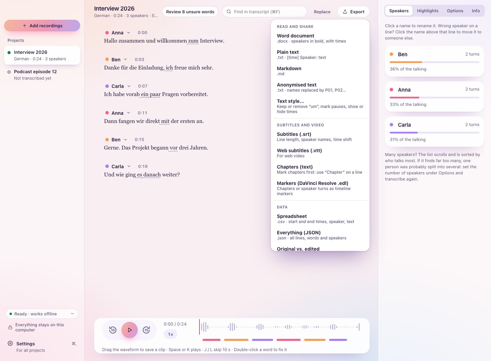

# Exporting

Open a project and choose **Export** (or press `⌘E` / `Ctrl+E`). Exports always use the speaker names you
entered (unnamed speakers appear as "Speaker 1", "Speaker 2", …) and your corrected text.

The menu is grouped: **Read and share** (Word, text, Markdown, anonymised, Text style), **Subtitles and video**, and **Data**. The table lists every item.

| Menu item | File | What's in it |
| --- | --- | --- |
| Word document | `.docx` | A designed page: title, date, who talked how much (coloured bars), then each line with a coloured rule for the speaker, the name and the time. Chapters become shaded headings. Opens in Word, Pages and Google Docs. |
| Plain text | `.txt` | `[00:00:03] Anna: text`, one line per speaker turn. |
| Spreadsheet | `.csv` | Start and end as seconds and as `h:mm:ss`, speaker, text, and flag columns (see below). Opens in Excel, Numbers and Sheets. |
| Subtitles | `.srt` | Subtitle cues for video editors and players. Has options (below). |
| Web subtitles | `.vtt` | The same cues in WebVTT, for web video. Has the same options. |
| Meeting minutes | `.docx` | The summary (if you wrote one, see [Highlights](highlights.md#summary)) with topics, attendees, a "Decisions and action items" list made from the lines you **Mark** (plus the summary's decisions and action items), your highlights as "Key quotes", then the full record with chapter headings. |
| Highlights and marked lines | `.txt` | Every highlight and every marked line, each as a quote with the speaker and time. Greyed out until you have one. |
| Highlights | `.docx` | The same quotes in a Word file, with the reason next to each one. |
| Original vs. edited | `.txt` | Every line you changed, with the original text and your edit, for an audit trail. Says "0 edited lines" if you changed nothing. |
| Anonymised text | `.txt` | Speakers become `P01`, `P02`… in order of first appearance, and any speaker name you typed is replaced by `[name]` wherever it appears in the text. Other names that are spoken (people, places) are **not** removed: read it before you share it. |
| Markdown | `.md` | Speaker and time headings with the text under them. |
| Everything (JSON) | `.json` | All lines (with marks, language, translation and overlap flags), words with timings, and speakers, for other programs. |
| Chapters (text) | `.txt` | A `0:00 Title` list. Needs at least one chapter; see [Chapters](chapters.md). |
| Markers (DaVinci Resolve) | `.edl` | Chapters (or speaker turns) as timeline markers. Has options (below). |

**Export all as CSV** (sidebar, shown when two or more projects are finished) writes one spreadsheet with a
`project` column followed by the usual columns.

The **Text style…** item at the bottom of the menu is not an export; it sets how the text formats are written (below).

If saving fails, the menu shows **Export failed:** with the reason. Cancelling the save window shows nothing.

## Text style

**Export, Text style…** (see also [Verbatim, pauses and timestamps](verbatim.md)) sets how Word, text, Markdown, spreadsheet, minutes and anonymised exports are written. The
choice is remembered. Your transcript itself is never changed.

- **Hesitations:** *Keep them* (verbatim, the default) or *Remove them* (clean copy). The clean list is short and
  depends on the recording's language (German äh/ähm, English uh/um/er, French euh, Spanish eh/em); other languages are left
  untouched. A clean copy says so at the top, so nobody mistakes it for a word-for-word record. Whisper sometimes leaves
  hesitations out by itself, so *keep them* cannot guarantee a verbatim record either.
- **Mark pauses:** `(.)` about half a second, `(..)` about one second, `(...)` two seconds or more, from the word timings. Lines you edited
  keep their text without marks.
- **Show times:** turn the `[0:03]` stamps off in text, Markdown and Word. The spreadsheet always keeps its time columns.

## Languages, translations and overlap in exports

- A line in a language different from the recording's is written as `Name [fr]:` in text, Markdown and Word, and appears in the
  `language` column of the spreadsheet and in the JSON.
- An **English translation** (if the line has one) is written under the line: `→ text` in text and Word (grey italics), a quote
  block in Markdown, and the `translation` column of the spreadsheet. The anonymised export leaves translations out.
- Where two people talk at once the line is written as `Name [overlap]:` (together with the language when both apply), and the
  spreadsheet has `yes` in the `overlap` column.
- The spreadsheet's columns are: start and end (seconds), start and end (`h:mm:ss`), speaker, text, `overlap`, `language`,
  `translation`. New columns are always added at the end, so existing spreadsheet formulas keep working.

## The app's language in exports

The words the app writes itself follow the language you chose under Settings, Language: headings in the Word document and the
minutes ("Attendees", "Decisions and action items", …), the footer, the long date, "speakers", the notes about clean copies and pause marks,
and the labels in the original-vs-edited file. Speaker names, the text, and file names are never translated.

## Subtitle options

Shown when you choose Subtitles or Web subtitles. The last values you used are remembered.

- **Maximum characters per line:** 20–60, default 42. Lines break at word boundaries.
- **Maximum lines:** 1 or 2, default 2.
- **Put speaker names in subtitles:** on by default; the name starts the first cue of each speaker's turn.
- **Shift all times by (seconds):** to line subtitles up with an edited video. Times never go below zero.

A cue lasts at most 7 seconds and at least 1 second where possible. Subtitles are built from the word timings, so
they follow the speech closely.

## Marker options (DaVinci Resolve)

- **Frame rate:** 24, 25, 30, 50 or 60. **Start timecode:** default `01:00:00:00`, matching a typical Resolve timeline.
- One marker per chapter. If you haven't marked chapters, one marker per speaker turn (named with the speaker and
  the first words).

## Backup file next to the recording

If **Settings → Saving** is on, after each transcription the app writes `name.transcript.json` next to the
recording. It is a backup this app can read again, not a document to send; use Export for that.
