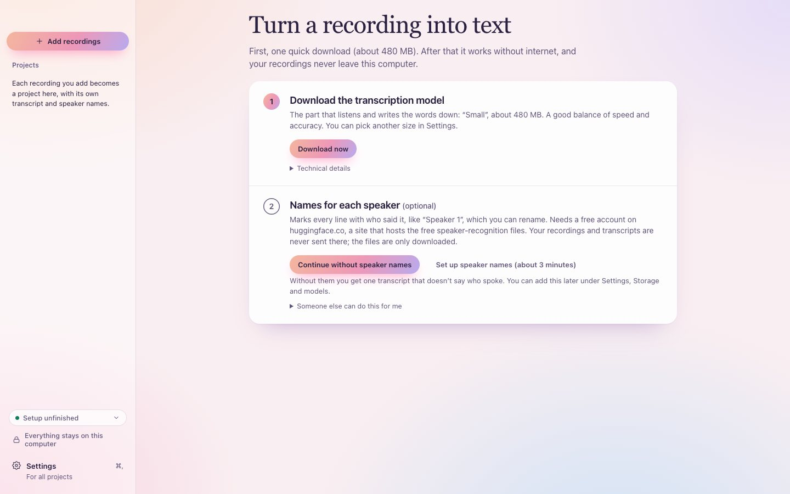
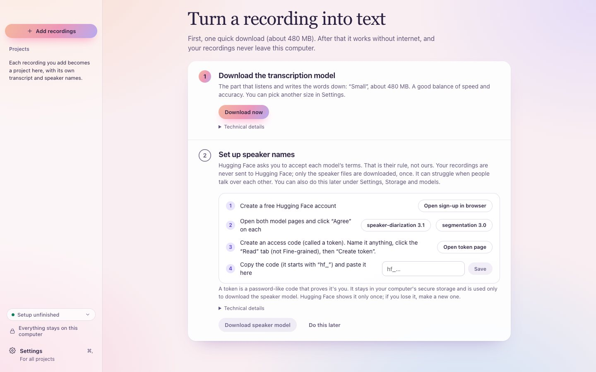
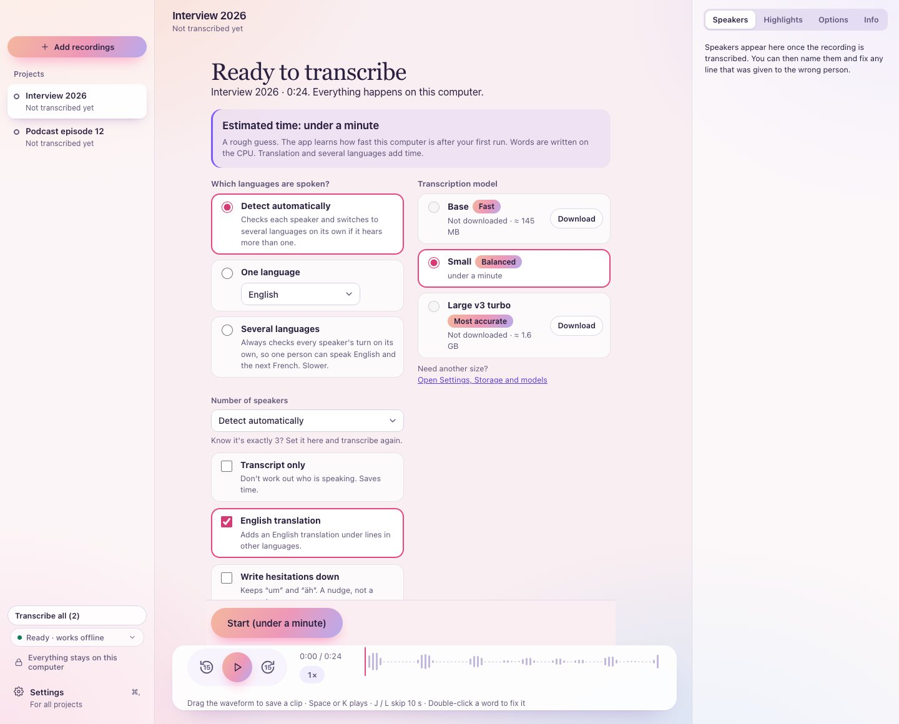
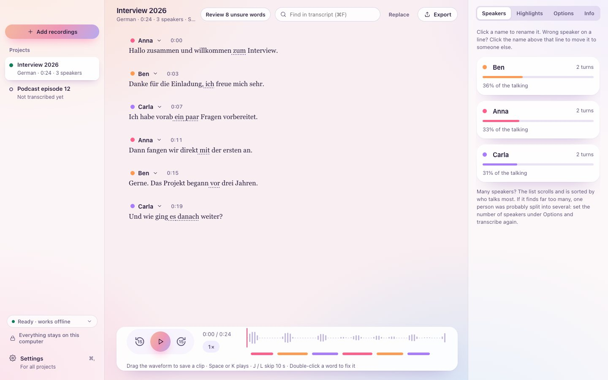

# Getting started

> Only macOS (Apple silicon) has been tested. Windows and Linux builds exist in the build setup but have not been tried.

The app opens in your computer's language if it has it (English, Deutsch, Français, Español); change it under Settings, Language.

## 1. Start the app

From a source checkout (a packaged installer is not published yet; building one is described in
[Development](development.md)):

```bash
cd engine && uv sync        # once: installs the Python side
cd ../app && npm ci         # once: installs the app
npm run dev                 # starts the app
```

Step-by-step instructions for macOS and Windows, including installing Git, Node.js and uv, are in the
[README quick start](../README.md#quick-start).

## 2. One-time setup (first launch)

The first screen is called **Turn a recording into text**. It says: one quick download, then it works offline.



1. **Download the transcription model.** Click **Download now** (about 480 MB for the default "small" size; Windows shows the same file as about 458 MB, see [file sizes](using-the-app.md#file-sizes)). Keep
   the app open until it finishes. After this, transcribing needs no internet.
2. **Tell speakers apart (optional).** Only needed when more than one person speaks in a recording, such as an
   interview or a meeting. Each line then says who is talking: Speaker 1, Speaker 2 and so on. It needs a second,
   small download (about 60 MB) from Hugging Face, which requires a free account. The **i** next to the heading
   explains what speaker detection (diarization) does. Choose **Set up speaker detection** (about 3 minutes) or
   **Continue without it**; you can add it later under **Settings → Storage and models**.

### Setting up speaker detection

The setup shows four steps and opens only the one to do now, marked **Do this now**. Finished steps shrink to a
one-line summary with a tick, and a bar shows how many are done and roughly how many minutes are left.



1. **Create a free Hugging Face account.** **Create account** opens the sign-up page. Already have one? Click
   **I already have one**.
2. **Make an access code (a token) and paste it here.** **Open token page** opens Hugging Face with the **Read** tab
   already chosen. Name the token “Local Transcriber” (**Copy name** puts that on your clipboard), click
   **Create token**, copy the code (it starts with `hf_` and is shown only once) and paste it into the app.
   Once saved, the step shows **Saved as hf_…abcd** with a **Replace** link.
3. **Fill in a short form on two model pages.** The makers of the speaker model (pyannote) ask for a few details before
   you can download it. Both pages (`speaker-diarization 3.1` and `segmentation 3.0`) have the same free form:
   - **Company or university** and **Website** are required. No company? Write *Freelance*, *Independent* or
     *Personal use*. For the website, the app shows your own Hugging Face profile address
     (`https://huggingface.co/your-username`) with a **Copy** button.
   - Agreeing shares your Hugging Face **email and username** with pyannote, who may email you about paid
     services. Your recordings are never shared. If you'd rather not share these details, skip speaker detection;
     transcripts still work.
   - Click **Agree and access repository** at the bottom of each form.

   Each page shows **Form not sent yet** or **✓ Accepted**. The app checks again when you come back to it from the
   browser, or when you click **Check now**. If Hugging Face can't be reached, **Download anyway** lets you go on.
4. **Download the speaker detection model** (about 60 MB, once). After that it works offline.

The token is stored with your operating system's secure storage and used only for this download. The app also
tells you if Hugging Face rejects the token, or if you made a Fine-grained token instead of a Read token.
If something goes wrong see [Troubleshooting](troubleshooting.md).

**Someone else can do this for you.** Ask a friend or your IT team to set up speaker detection once on their computer and
copy the `models` folder (its location is shown under Settings, Storage and models). On the first screen open
**Someone else can do this for me**, click **Import a models folder…** and pick it. Nothing goes online.
Only models this app knows are copied, and the app tells you if the folder has none.

## 3. Transcribe

1. Click **Add recordings** (or drop files on the window). You can add several at once. Audio and video files
   work: mp3, wav, m4a, flac, ogg, opus, aac, mp4, mov, mkv, webm.
2. Open a project and click **Start**. The app shows a time estimate first; **Change settings** lets you choose languages,
   model size and the number of speakers. Recordings are processed one after another; the sidebar shows which is
   running and which are waiting.


3. When it finishes, name the speakers, fix any mistakes, and export. See [Using the app](using-the-app.md).



Recordings with several languages: leave the language on auto-detect. The app checks each speaker and, if it finds several
languages, handles each speaker's turn on its own and can add an English translation under the other-language lines.

Want to try it first? Use the two files in [`samples/`](samples/).
