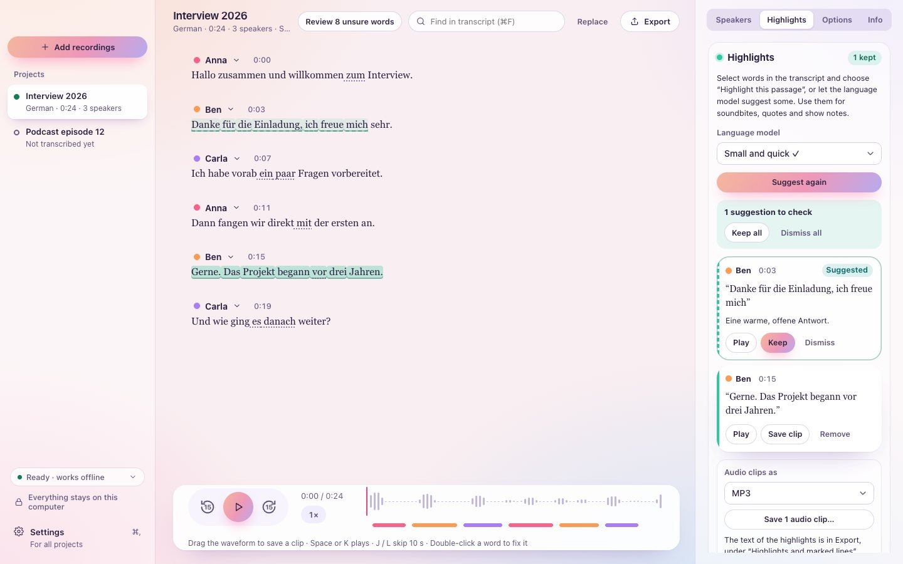
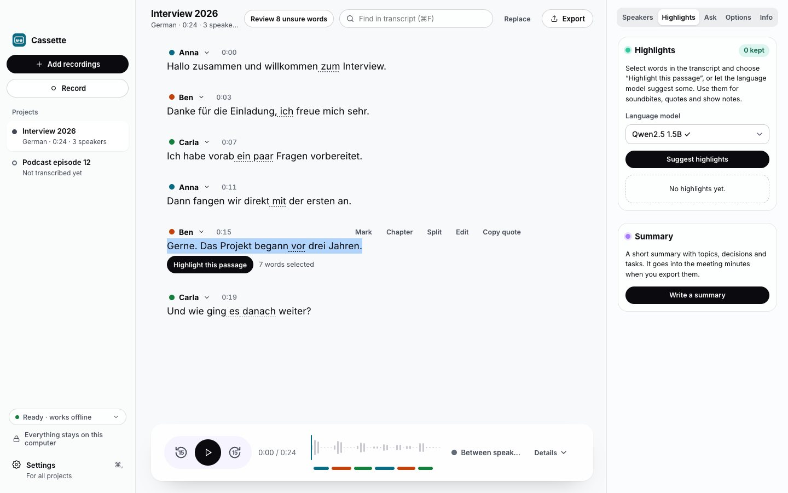
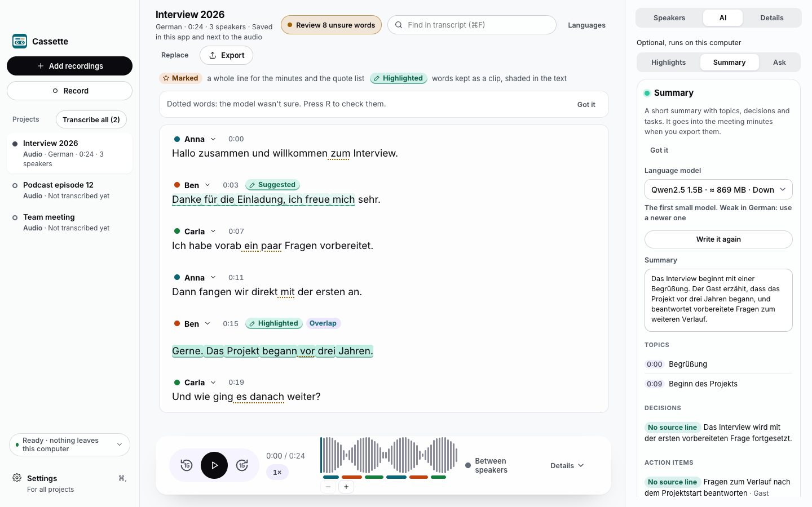
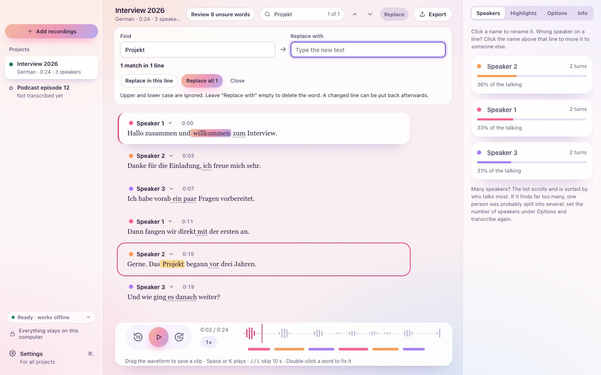

# Highlights, summaries and search and replace

Use highlights to find soundbites and quotes, then save them as text or as audio. A summary writes the minutes for you. Search and replace
fixes a word that was misheard everywhere at once.

## Highlight a passage

1. In the transcript, **select the words** you want with the mouse (at least two). A **Highlight this passage** button appears under the line.
2. Click it. The words turn mint green, and the passage is added to the **Highlights** tab on the right.

You can also select words while you are editing a line (**Edit**) and click **Highlight selection** next to **Save**.

A highlight remembers the stretch of the recording, not the line, so it stays correct when you edit, split or join lines. Each highlight in the tab
has **Play** (plays just that passage), **Show in the transcript** (click its time), **Save clip** (that passage as one audio file) and **Remove**.

**Mark** still works as before and flags a whole line. Marked lines go into the quote list and the minutes. If a marked line already holds a
highlight, only the highlight is listed in the quote list.

## Let the language model suggest highlights

**Suggest highlights** reads the transcript and picks the passages that are most quotable: short, self-contained, insightful, surprising or
decisive. Each suggestion comes with a one-line reason. Suggestions have a dashed edge and a **Suggested** flag, in the tab and in the transcript.
**Keep** turns one into a normal highlight, **Dismiss** removes it, and **Keep all** / **Dismiss all** answer every suggestion at once. **Suggest again**
replaces the suggestions you haven't answered yet and never touches the highlights you kept.

The words and times of every suggestion come from your transcript, never from the model: if the model quotes something that isn't in the line it
names, that suggestion is dropped. The model can still pick passages you find dull or miss ones you like, so treat the list as a starting point.

### The language model

The suggestions and the summary are written by a small language model that **runs on your computer**. Nothing is sent anywhere. It is a one-time
download, offered when you first press **Suggest highlights** or **Write a summary**, or any time under Settings, **Storage and models**,
**Language model**. There you can download several, delete them, and press **Use** to choose the one every project uses. You can also switch
in the **Language model** menu of the Highlights tab.

| Model | Download (Mac with an Apple chip / elsewhere) | Use it when |
| --- | --- | --- |
| Qwen3 1.7B | about 1.0 GB / 1.1 GB | Short recordings and clear speech, or an older computer. |
| **Qwen3 4B** (recommended) | about 2.3 GB / 2.5 GB | Most recordings. A good balance of quality and speed. |
| Gemma 3 4B | about 2.6 GB / 2.5 GB | An alternative to Qwen3 4B that is very good across languages. Its licence is Google's Gemma terms, not an open-source licence. |
| Qwen2.5 7B | about 4.3 GB / 4.7 GB | Longer recordings and better summaries, if you have the space and the patience. |

All of them work in German, English, French and Spanish. The Qwen3 and Gemma models were tried on the English and German sample interviews
before they were added to the list. Reasons and summaries are written in the language of the recording. If you downloaded the earlier *Small and quick* model (Qwen2.5 1.5B),
it stays in the list so you can keep using it or delete it; it is weak in German, so a newer one is better. On a Mac with an Apple chip it runs on the graphics chip through MLX. On Windows and Linux it runs on llama.cpp; **that path has not
been tested yet**. If a build of the app does not include the language model, the tab says so and highlighting by hand keeps working.

## Save highlights

- **As audio:** in the Highlights tab, choose MP3, M4A or WAV and press **Save N audio clips…**. Pick a folder; the app makes a subfolder called
  *name highlights* with **one file per highlight**, numbered in the order they occur, for example `01 - Anna - 0m12s.mp3`. Each clip has a third of a
  second of room on both sides, so it doesn't start or stop mid-breath. To save just one, press **Save clip** on that highlight.
- **As text:** **Export → Highlights and marked lines (text)** writes every highlight and every marked line as a quote with the speaker and time.
  **Export → Highlights (Word)** does the same in a Word file, with the reason next to each suggestion you kept.

Highlights you haven't answered yet (still suggested) are not exported.

## Summary

**Write a summary** (in the Highlights tab, below the highlights) writes:

- a short summary of what the conversation was about;
- **Topics** with the time each one starts (click a time to play from there);
- **Decisions** that were made;
- **Action items**, with who is responsible when it was said.

Long recordings are summarised in pieces first and then combined. You can **edit the summary text** in place (it saves when you click away),
**Copy** the whole summary, **Write it again**, or **Remove** it. The model is told to use only what was said, but it can still make mistakes, so
read it before you share it.

When you export **Meeting minutes (Word)**, the summary, its topics, decisions and action items come first, then the lines you marked, then the
highlights as **Key quotes**, then the full record. The summary is marked in the file as written by a language model.

## Search and replace

1. Type the word in the find box (`⌘F` / `Ctrl+F`). Matches are highlighted.
2. Press **Replace** next to the box. A bar opens under the toolbar.
3. Type the replacement and press **Replace in this line** (the line you are on; `Enter` does the same) or **Replace all**.

Capital letters and accents are ignored when looking for matches (so `lucia` finds `Lucía`), and the replacement is inserted exactly as you typed it. Every changed line shows **Edited** with
**Put back what the model heard**, so a replacement can be undone line by line, and the changed text is what exports use. If your replacement has a different
number of words than the original, the words in that line are spread evenly over the line's time, exactly as with any other edit.

Two switches under the toolbar, **Match case** and **Whole word**, narrow the search (with Whole word on, `projekt` does not match `Projekte`). They apply to Replace too. **Replace all** first lists every line it would change, with the old text struck through and the new text beside it, and marks lines where an unsure word is affected; press **Replace all** again to confirm, or **Back**.

The whole text you type has to appear in the transcript: `deutsche` does not match a line that only says `Deutsch`. When nothing matches, a line under the toolbar says so and offers the closest words in the transcript (for example `Deutsch (3)`); click one to search for it.
