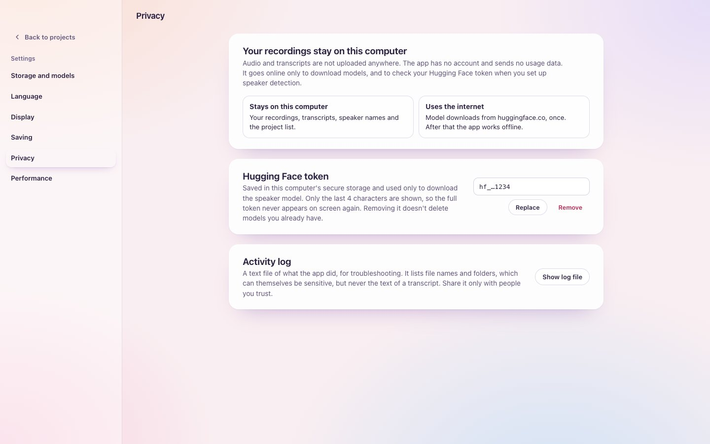

# Privacy and offline use

## The short version

- Your recordings and transcripts **stay on your computer**. There is no account, no cloud copy and no usage
  tracking.
- The app goes online **only to download models** (and to check your Hugging Face token while you set up speaker
  detection). After that it works offline.

Settings → Privacy says the same in the app, and lets you see or remove your saved token:

## What the app connects to

| When | Where | Why |
| --- | --- | --- |
| Downloading a transcription model | huggingface.co | Fetches the model files once. |
| Setting up speaker detection | huggingface.co | Checks your token (and learns your username, to show your profile address) and fetches the speaker models once. The model pages' own forms, which you send in your browser, share your Hugging Face email and username with the model's makers (pyannote). |
| Downloading the language model (for highlights and summaries) | huggingface.co | Fetches the model files once. No account or token needed. |
| Transcribing, exporting, everything else | nothing | Runs fully offline (the engine is started with offline mode on). |

Hugging Face may serve files from its own content hosts; the app does not contact anything else. Links you click
in the setup steps open in your normal browser, and only huggingface.co links are allowed.

Translations (to English) and mixed-language detection are done by the same local speech model; nothing is sent anywhere. Suggested highlights and summaries are written by a language model on your computer, which runs with offline mode on like the speech model. Your transcript is never sent to a service.

## What is stored, and where

Inside the app's data folder (Settings → Privacy → *Open*, or Settings → Saving → *Show app folder*):

- **Projects:** names, transcripts, speaker names and your edits (`projects.json`).
- **Models:** the downloaded models (Settings → Storage and models shows the exact path and size).
- **Hugging Face token:** encrypted with your operating system's secure storage. Only the last 4 characters are
  ever shown in the app.
- **Marks, highlights and summaries:** the Mark flag, your highlights (with the text of each) and any summary are saved with your project. The minutes, quote list, highlight clips, original-vs-edited and
  anonymised exports contain transcript text, like any export.
- **Activity log:** a text file of what the app did. It lists file names and folders, which can be sensitive
  themselves, but never the text of a transcript.

Next to a recording (only if Settings → Saving is on): `name.transcript.json`. Your audio file is never changed
or moved.

## Removing things

- **Remove a project:** the **×** on the project in the sidebar removes it and its transcript from the app. It
  does not touch your recording or any backup file next to it.
- **Remove models:** Settings → Storage and models → Delete.
- **Remove the token:** Settings → Privacy → Remove.
- **Everything:** quit the app and delete its data folder.

## Honest limits

- These statements come from reading the code, not from an independent security audit.
- Speaker detection uses Hugging Face models that require you to accept their terms with your own account. The app
  does not redistribute them.
- Unsigned builds will show an operating-system warning the first time you open them.
- Exports contain whatever is in your transcript; check them before you send them.

See also [SECURITY.md](../SECURITY.md) and [THIRD_PARTY_NOTICES.md](../THIRD_PARTY_NOTICES.md).
