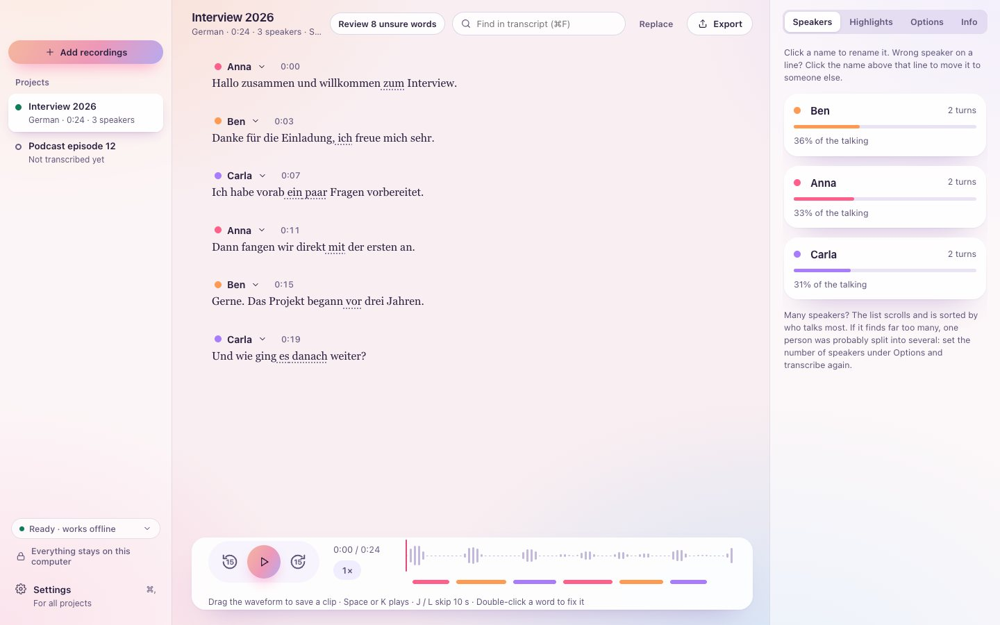

# Quick start (5 minutes)

1. **Start the app** (see [Getting started](getting-started.md)).
2. **Download the transcription model.** Click **Download now**: about 480 MB, once. Under **Tell speakers apart**, choose **Continue without it** for now; you can add it later.
3. **Add a recording.** Drop a file on the window, or try one from [`samples/`](samples/).
4. **Press Start.** The sidebar shows progress. Everything runs on your computer.
5. **Press play.** The line being spoken is highlighted. Click any line to jump there.
6. **Fix and name.** Double-click a line to fix the words. Click a speaker's name to rename them everywhere.
7. **Export.** Press `⌘E` / `Ctrl+E` and choose Word, subtitles, a spreadsheet and more.

Want to see every screen first? Take the [tour](tour.md). Next: [Recipes](recipes.md), [Which model size?](models.md), [Glossary](glossary.md), [FAQ](faq.md).
