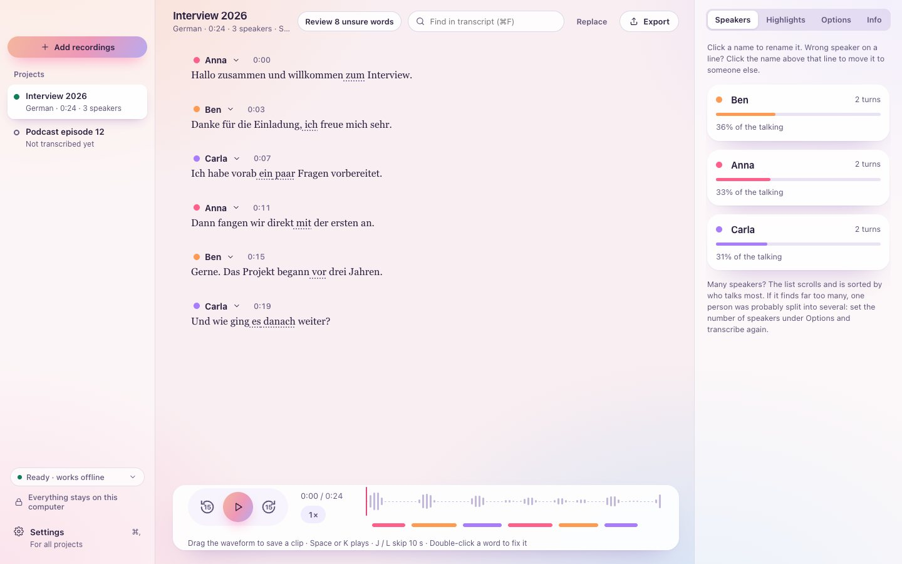
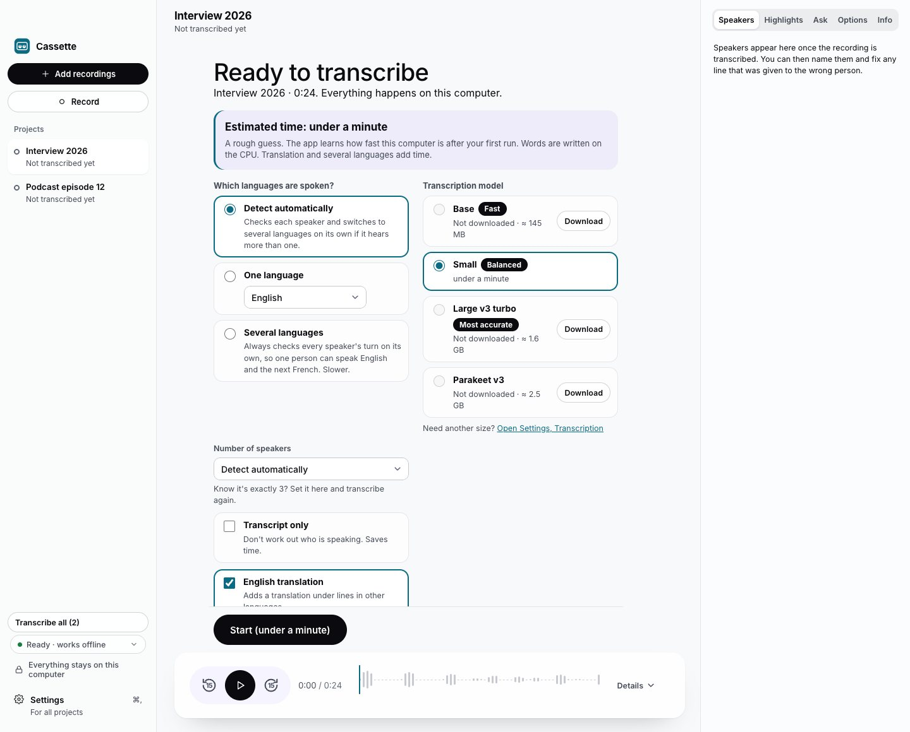
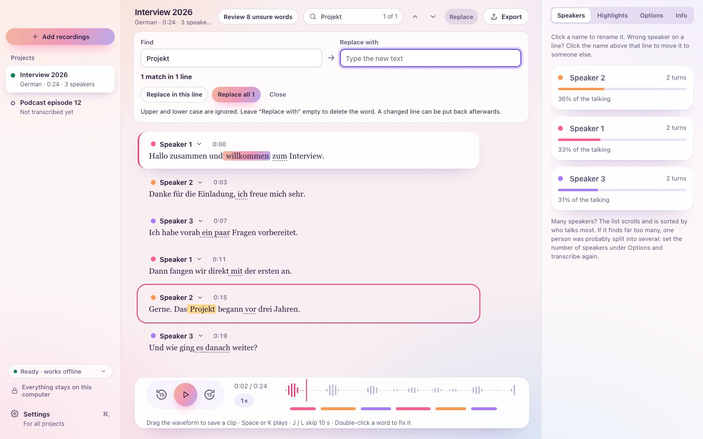
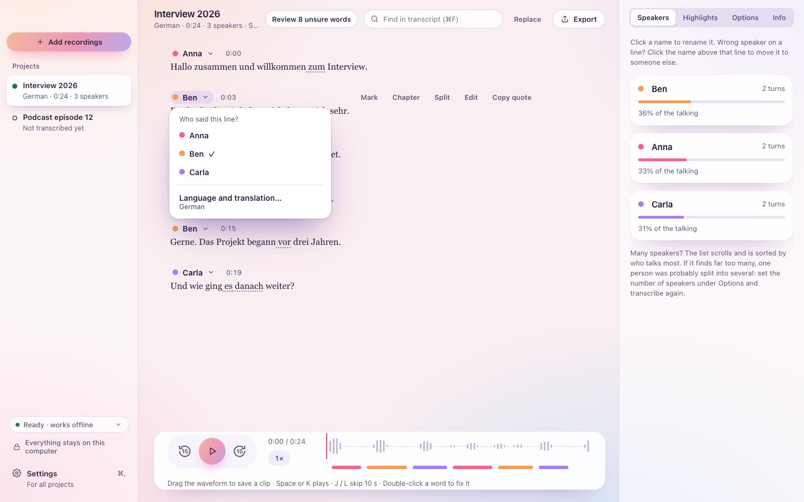
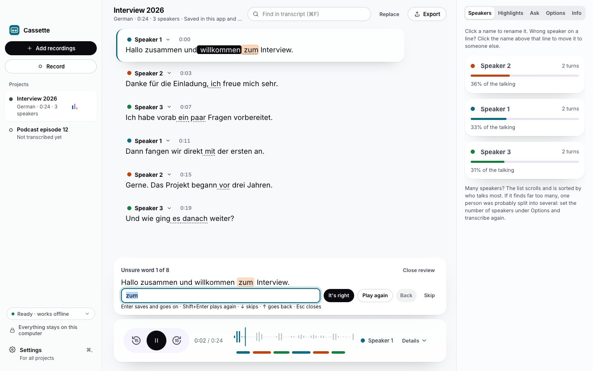
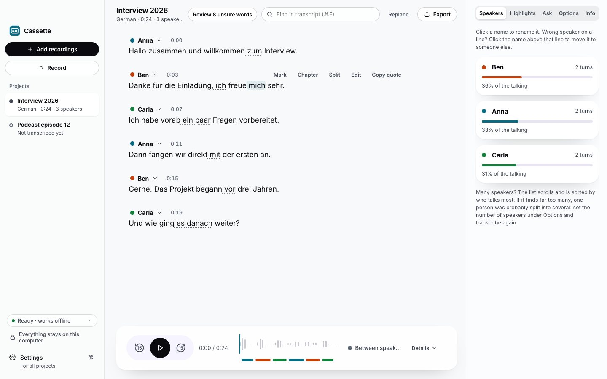
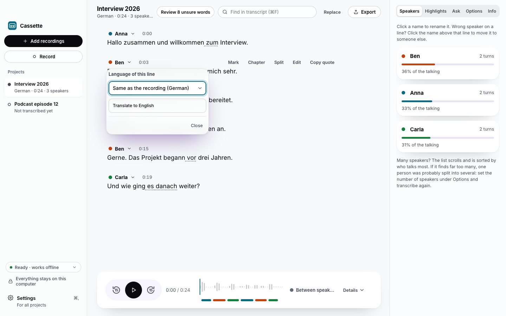
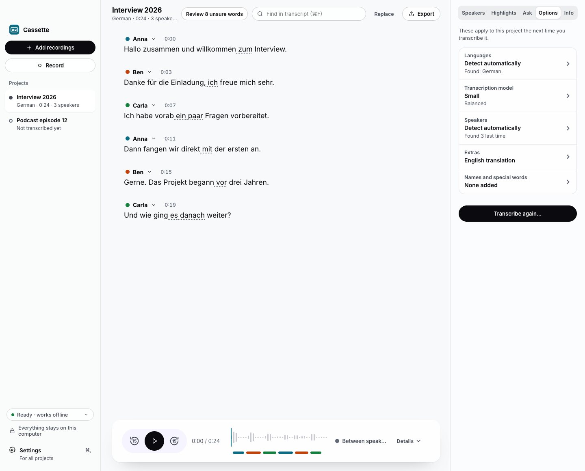
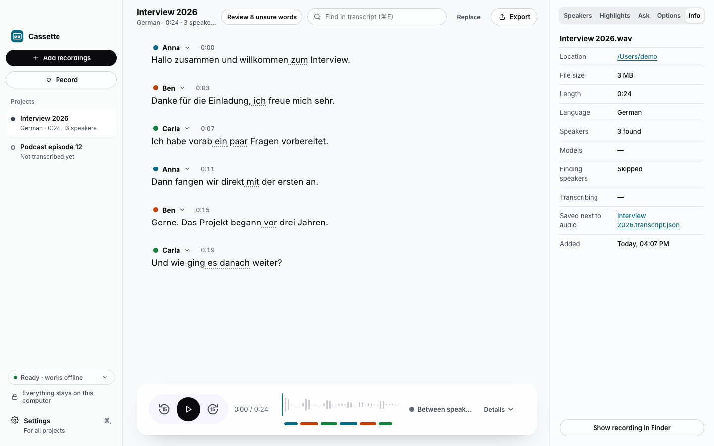

# Using the app

> New here? The [tour](tour.md) shows every screen in order.

## The screen

- **Left: your projects.** Each recording you add becomes a project with its own transcript and speaker names.
  A dot shows its state (done, running, waiting, not transcribed). Projects are kept inside the app, so they are
  still there after you restart. Removing a project from the list (the **×**) never deletes your recording.
  With two or more finished projects there is also **Export all as CSV**. At the bottom: the activity status, the
  privacy reminder, and **Settings**.
- **Middle: the transcript** and, along the bottom, the audio player.
- **Right: the inspector** with four tabs: **Speakers**, **Highlights**, **Options**, **Info**.

If something is playing and you open another project or Settings, the project row shows animated bars and a
**Now playing** pill with a **Pause** button follows you to every screen. Starting a second recording pauses the first.

## Before you start transcribing

Opening a recording that hasn't been transcribed shows **Ready to transcribe** with an **estimated time**, always. If the estimate is **over a
minute**, the questions are shown too, so you can choose before spending the time:

- **Which languages are spoken?** *Detect automatically* (the app checks each speaker), *One language*, or *Several languages*.
- **Number of speakers:** detect automatically, an exact number, or a range. **Transcript only** skips speaker detection and saves time.
- **Transcription model:** Fast, Balanced or Most accurate (Base, Small, Large v3 turbo), each with its own estimate. Sizes you haven't downloaded
  are marked, with a link to Settings.
- **English translation** and **Write hesitations down**.

Your choice of model and the two extras are remembered for new recordings; the speaker and language answers belong to this recording. With
several recordings waiting, **Use these settings for the other waiting recordings** copies your answers to them.

The estimate is a rough guess (shown as a range, and labelled so) until the app has timed a full run on your computer. After that it uses the
real speed for that model and engine, and the range narrows. Runs with translation or per-speaker languages aren't used for timing because they
are slower for other reasons, so the estimate can be low for those. If you're on battery and the job will take over ten minutes, the sheet says so.

**Try the first 3 minutes** (shown for recordings longer than six minutes) transcribes only the start, with your settings, so you can check
speakers and languages first. The result carries a banner saying it is a sample, with a button to transcribe the whole recording (which replaces
the sample).

## Reading and playing

- Click a word, or the time next to a line, to play from there. The current word is highlighted. Double-click a word to fix it (see below).
- Words the model was unsure of have a dotted underline. Check those first, or press **Review N unsure words** (top of the
  transcript, shown while there are any) to go through them one at a time; see [Reviewing unsure words](#reviewing-unsure-words).
- **Player:** back 15 s, play / pause, forward 15 s. The small pill under the clock is the **speed** (0.75×, 1×, 1.25×, 1.5×, 2×);
  click it to step through the speeds. It turns coloured when it isn't 1×, and the app remembers your choice.
- **Keys:** `Space` or `K` play / pause, `J` back 10 s, `L` forward 10 s.
- Drag across the waveform to select a part. Then you can **Save clip** or transcribe just that part. Once a recording has
  a transcript, **Transcribe a part only** appears only while a selection exists, and it replaces only the lines in
  that stretch. Before the first transcript the button is always shown, greyed out until you select.
- The coloured strip under the waveform shows who speaks when.

## Finding things

Use the find box (`⌘F` on Mac, `Ctrl+F` elsewhere). Matches are highlighted; press `Enter` to jump to the next one.
On narrow windows the box is an icon until you click it.

**Replace** next to the box opens a bar to change every match, or just the one line you are on. See [Highlights, summaries and search and replace](highlights.md#search-and-replace).

## Speakers

- **Rename:** in the **Speakers** tab, click a name and type. The default name ("Speaker 1") disappears as soon as you click
  into the box. Names appear in the transcript and in every export. The bar shows each person's share of the talking.

- **Fix one line:** click the speaker name above a line and pick someone else. The panel then offers to move all
  the other lines of the speaker the model confused, and an **Undo**.
- **Wrong number of speakers?** Under **Options**, set the number of speakers (if you know it) and transcribe again.
  Too many speakers usually means one person was split into several; too few means voices were merged.
- **Several people in one line?** Use **Split** (below), then change the speaker of each part. Very short turns, like
  one-word answers, are close to the limit of what speaker detection can separate, so expect to fix a few by hand.
- **Overlap:** where two people talk at once the line shows an **Overlap** tag. The words still go to one speaker, the louder one.

## Reviewing unsure words

Words the speech model was unsure of have a dotted underline (hover one to see why). With one or more of them in a transcript the toolbar shows
**Review N unsure words**. It starts a guided pass:

- A card above the player shows the word inside its sentence and plays the audio around it (a second or so before, a moment after). The
  transcript scrolls to the line and highlights the word.
- The box holds the word, already selected. Type the correction and press `Enter` (the button says **Save fix**). If the word is right, just press
  `Enter` (the button says **It's right**) and the word stops being marked. Empty the box and press `Enter` to remove the word.
- A replacement of several words shares the old word's time slot. Only that word changes: other unsure words in the line stay unsure, and the
  line shows **Edited** with **Put back what the model heard**, like any edit.
- `↓` or **Skip** moves on and leaves the word marked; `↑` or **Back** returns. `Shift+Enter` or **Play again** replays the sound. Typing stops the
  sound. `Esc` or **Close review** leaves review mode.
- At the end the card says all words are checked, or how many you skipped, with **Go through them again**.
- If you open Settings and come back, review is where you left it.

| Keys | Does |
| --- | --- |
| `Enter` | Save the fix (or confirm the word) and go to the next one |
| `Shift+Enter` | Play the word again |
| `↓` / `↑` | Skip / go back |
| `Esc` | Close review |

Review only looks at words the model flagged. It cannot find mistakes the model was sure about, so it isn't a substitute for listening to
important passages. It has been tried in the browser mock with a fake sound, not with real audio in the desktop app.

## Fixing and annotating lines

Hover a line to see its buttons: **Mark**, **Split**, **Chapter**, **Edit**, **Copy quote**. Clicking the speaker name opens a menu
to change the speaker, with one more item for the language and translation of the line. The language tag opens that dialog directly.

- **Edit**: opens the whole line for editing. **Double-click a word** to open the editor with that word already selected, so you can type
  straight over it. Audio that wasn't playing before your double-click stays stopped. Press `Enter` to save (`Shift+Enter` adds a
  line break) or `Esc` to cancel. Editing the whole line, not one word, keeps the sentence around it visible. If you keep the same
  number of words, each word keeps its timing; otherwise the words are spread evenly across the line. An edited line shows **Edited**
  and **Put back what the model heard**. Exports use your corrected text.
- **Copy quote** copies `Name (0:03): text`.
- **Mark** flags a line as a decision, an action item or a quote. Marked lines show a **Marked** flag and an orange edge. Click again
  to unmark. They are what the meeting minutes and the quote list are built from (see [Exporting](exporting.md)).
- **Highlight a passage:** select words in a line and click **Highlight this passage**. Highlights are listed in the **Highlights** tab, where you can
  play them, save them as audio clips and let a local language model suggest more or write a summary. See [Highlights, summaries and search and replace](highlights.md).
- **Chapter** marks where a topic starts. See [Chapters](chapters.md).
- **Split** breaks a line in two: click it, then click the word where the new line should start. **Join with previous line** (in the
  same mode) undoes it. Splits are not listed in the Original vs. edited export.

### Languages in a recording

- **Language of a line:** a small tag (for example `FR`) shows the line's language. In a recording with several languages every line has a tag;
  otherwise only lines that differ from the recording's language do. Click the tag, or click the speaker name and choose **Language and
  translation…**, to open a small dialog with a **Language of this line** dropdown and the actions below. Choosing a language does not change the
  text. To redo the text, press **Transcribe this line again in…** there: that stretch is transcribed again in that language (without speaker
  detection; the line keeps its speaker). `Esc` or **Close** closes the dialog and returns you to the speaker name.
- **Translation:** lines in a language other than English can show an English translation underneath (see *English translation*
  under Options). For one line, use **Translate to English** in the language dialog; **Remove the translation** takes it away. Whisper can
  only translate *into English*, so there is no translation into German, French or Spanish. Machine translation can be wrong; treat it as a gist.

## Options (per project)

These apply the next time you transcribe that project:

- **Language of the recording:** auto-detect, or any language Whisper knows (about 100). German, English, French and Spanish are listed
  first and are the best tested; the others work but accuracy varies, especially with small models.
- **Mixed languages** (only with auto-detect): **Automatic** (the default) first checks the language of each speaker. If it finds
  several, it detects the language separately for each speaker's turn, so one person can speak English and the next French; every
  line gets its language tag and the header says "Mixed languages". *Always check each speaker* skips the check; *Off* uses one language
  for the whole recording. It needs speaker detection (with *Transcript only* on, the check is skipped). It cannot follow a switch inside
  one turn, and turns under about a third of a second are skipped. See the [FAQ](faq.md) for what has and hasn't been tested.
- **Transcription model:** only downloaded models can be chosen. Download more under Settings. See [Which model size?](models.md).
- **Number of speakers:** automatic, an exact number (1 to 6), or **a range** (at least / at most). A range is often easier than an
  exact number when you are only fairly sure.
- **English translation:** adds an English translation under lines in other languages. On by default when the app is in English.
  It adds time to the transcription.
- **Write hesitations down:** asks the speech model to keep "um", "äh", "euh" and "eh" instead of tidying them away, by giving it a short
  sample sentence with hesitations in the recording's language (German, English, French, Spanish; other languages get no sample). It is a
  nudge, not a guarantee, and it has only been checked on clean text-to-speech samples, which contain no hesitations. For what the *export*
  does with hesitations, pauses and times, see *Text style* in [Exporting](exporting.md) and [Verbatim, pauses and timestamps](verbatim.md).
- **Skip silence:** ignores long pauses. Faster, but can miss quiet speech.
- **Transcript only:** don't work out who is speaking.
- **Names and special words:** a list (for example `Müller GmbH, pyannote`) that helps the model spell them.
- **Transcribe again…** replaces the transcript. The app asks first, because your speaker names and edits are lost.

## Info

File name, location (click to show it in your file manager), file size, length, language (or the languages found), how many speakers
were found, which models ran, how long each step took, whether a backup file was saved, and when you added it.

## Settings

Open with the **Settings** row, or `⌘,` / `Ctrl+,`.

Settings has two groups of pages and a search box. **Jobs:** Overview, Transcription, Speakers, Summaries and translation. **App:**
Saving and export, Text and language, Privacy, Advanced. **About** is at the bottom of the list. Press Enter in the search box to open
the first match.

- **Overview:** can I transcribe? One line per job (transcription, speakers, summaries) with its state in words and one button. It also
  has **Use a models folder…** for models someone else downloaded (see [Getting started](getting-started.md)).
- **Transcription:** pick an **engine** (Whisper; Parakeet and Moonshine where they can run), then a model. Every model row shows its size,
  its state (*In use*, *Downloaded*, *Not downloaded*) and **Use**, **Download** or **Delete**. Choosing an engine only changes the list; the model
  in use changes only when you press **Use** (there is an Undo). Deleting the model in use offers **Delete and use** another downloaded model.
  The **language of recordings** block follows the model in use: Whisper can find the language by itself; Parakeet cannot (it uses a Whisper model, or
  you choose); Moonshine has one model per language. Quick picks (*Faster*, *In the middle*, *Fewer mistakes*) choose a Whisper size.
- **Speakers:** what speaker detection does and the four guided steps (Hugging Face account, a Read token named *Local Transcriber*, two short forms, the
  download), the same as on the first screen. Once it is set up you can switch it off for new projects, or delete it.
- **Summaries and translation:** the language model for highlights and summaries, and the translation model, each with **Use** and **Delete**.
- **Saving and export:** optionally save a backup file (`name.transcript.json`) next to each recording after transcribing. Transcribing the same
  recording again replaces that file. Your audio is never changed or moved.
- **Text and language:** **Text size** (four sizes, scales the whole app), **High contrast**, the language of the app (*Match my computer*, English,
  Deutsch, Français or Español; the translations are machine-assisted and not yet reviewed), **Light or dark**, the **colour mood** (*Fairytale sunset*,
  *Cloudy Tuesday*, *Open-plan office*), and the keyboard shortcuts. The language of a recording is separate (see Options).
- **Privacy:** what stays on your computer, a table of every network call, a table of what is stored where (with **Show** buttons), your saved token (only the
  last 4 characters are shown), and the activity log. See [Privacy and offline use](privacy-and-offline.md).
- **Advanced:** closed groups, nothing needs changing. *Processor*: *Automatic* uses your graphics chip when there is one; *Processor only* is slower and most
  compatible. On a Mac with an Apple chip you can also download the **Apple GPU** versions of Whisper (see [Which model size?](models.md)). *Language
  checker*, the *Models folder* (path, free space), **Copy diagnostics**, the activity log and **Reset all settings**.

## The status pill

The pill at the bottom of the sidebar says **Ready · works offline** when nothing is running, and shows the current
step when something is. Click it for a plain-language list of recent activity, with **Technical details** for the
raw log.

## File sizes

The app shows sizes the way your computer does, so the numbers match your file manager. macOS and Linux count
1 GB as 1,000,000,000 bytes; Windows counts in units of 1,024 but still writes "GB". The same file therefore reads
a little smaller on Windows (a 486,215,847-byte model is 486 MB on a Mac and 464 MB on Windows). Nothing is different
on disk. Model sizes that haven't been downloaded yet are approximate ("≈").

## Keyboard summary

| Keys | Does |
| --- | --- |
| `Space`, `K` | Play / pause |
| `J`, `L` | Back / forward 10 seconds |
| `⌘F` / `Ctrl+F` | Find in the transcript (**Replace** opens next to it) |
| `⌘E` / `Ctrl+E` | Open the Export menu |
| `⌘,` / `Ctrl+,` | Open Settings |
| `Enter` | Save an edit (`⌘/Ctrl+Enter` also works) |
| `Esc` | Close a menu or dialog, cancel an edit, close review |
| In review: `Enter`, `Shift+Enter`, `↓`, `↑` | Save and go on, play again, skip, go back |
